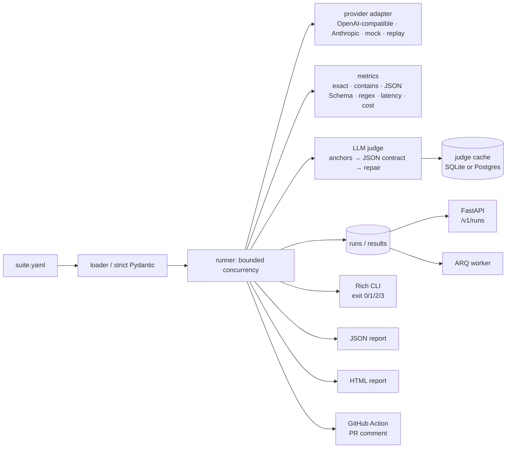

# EvalGate

> A regression-testing system for LLM features: define an eval suite in YAML, run it against
> any provider, fail the pull request when quality drops below threshold.

[](https://github.com/supremeyuma/evalgate/actions/workflows/ci.yml)
[](https://www.python.org/)
[](LICENSE)

Teams ship prompt changes with no tests. EvalGate turns a golden dataset into a CI gate:
per-case pass/fail, rubric-scored judges with anchors, a content-addressed judge cache, cost
and latency budgets, and a Wilson-interval regression rule that refuses to fail a PR on noise.

**The product is the eval semantics, not a UI.** The CLI, the JSON/HTML reports, and the
GitHub Action are the interface.

## Quickstart (offline, no keys)

```powershell
git clone https://github.com/supremeyuma/evalgate
cd evalgate
uv sync

uv run evalgate validate examples/support/suite.yaml
uv run evalgate run examples/support/suite.yaml --mock --json reports/support.json --html reports/support.html
```

`--mock` is a deterministic provider: no network, no API key, and every test runs offline.

To install the CLI on your PATH:

```powershell
uv tool install .
evalgate --help
```

## The demo that matters

```powershell
uv run python scripts/demo_regression.py
```

It runs the 40-case support suite twice with the mock provider: once with the healthy prompt,
then once with `--prompt-variant weakened`, comparing against the first run as the baseline.

| Run | Pass rate | Exit | What the gate says |
|---|---|---|---|
| Healthy prompt | 100.0% (40/40) | 0 | pass |
| Weakened prompt | 0.0% (40/40 fail) | 1 | 40 regressed cases; schema, required facts, and judge all fail |

The second run writes `reports/demo-comment.md`, the same markdown the Action posts:

```
## EvalGate - :x: failed
| Pass rate | 100.0% | 0.0% | -100.0 pp | :x: regression |
```

The weakened prompt returns `I don't know.` for every case, so the demo is deterministic.
A live demo with a real model needs a provider key; set it and drop `--mock`.

## Architecture



- **Strict suite contract.** Unknown keys are rejected; paths resolve relative to the suite and
  cannot escape the project root. See [`docs/eval-suite-spec.md`](docs/eval-suite-spec.md).
- **Per-case semantics.** A case passes only when every required metric passes
  ([ADR-001](docs/adr/001-per-case-semantics.md)).
- **Regression rule.** A drop counts only when it exceeds the configured threshold *and* the
  Wilson 95% intervals separate ([ADR-002](docs/adr/002-regression-rule.md)).
- **Judges, not vibes.** Anchored 1–5 rubrics, strict JSON output, one repair attempt,
  refusal handling, and a cache keyed by response + rubric + model + prompt version
  ([ADR-004](docs/adr/004-judge-cache-key.md)).
- **Hand-written adapters.** `httpx` only, no LangChain ([ADR-003](docs/adr/003-no-framework-adapters.md)).

## Eval suite format

```yaml
name: support-reply-quality
model: { provider: openai-compatible, name: gpt-4.1-mini, temperature: 0 }
prompt: prompts/support.md
cases_file: datasets/support.jsonl
metrics:
  - type: json_schema_valid
    schema: schemas/reply.json
  - type: llm_judge
    rubric: rubrics/helpfulness.md
    threshold: 4.0
  - type: cost_usd
    max: 0.01
limits:
  max_cost_usd: 0.50
  max_p95_latency_ms: 4000
regression:
  max_pass_rate_drop: 0.03
  min_cases: 10
```

Two complete examples ship in the repo: a 40-case support generation suite and a 30-case
intent classification suite, both runnable offline.

## Measured results (mock provider)

Numbers below are reproducible with `--mock`; they validate the plumbing, **not** model
quality or live cost.

| Measurement | Value |
|---|---|
| Support suite | 40 cases, 5 metrics, 100.0% pass, Wilson 95% CI 91.2–100.0% |
| Classification suite | 30 cases, 100.0% pass |
| Cold support run | 160 ms, 40 judge calls, judge cache 0% |
| Warm support run | 33 ms, 0 judge calls, 40/40 cache hits |
| Mock cost | $0.0000 by construction |
| Test suite | 235 tests, 91% coverage, mypy strict, zero live network calls |

**Live cost is an estimate, not a measurement.** The pricing table
([`pricing.yaml`](src/evalgate/providers/pricing.yaml), effective 2026-11-01) prices
`gpt-4.1-mini` at $0.40 / $1.60 per 1M input/output tokens. A 40-case run with one generation
and one judge call per case, at roughly 500 input + 200 output tokens per call, is on the
order of **$0.02–$0.04**. Run it with a key to replace the estimate with a measured number.

## Regression semantics

With `--baseline`, the gate is relative: cases that also failed in the baseline do not fail
the PR on their own. A regression requires all of:

1. at least `regression.min_cases` cases in both runs,
2. a pass-rate drop greater than `regression.max_pass_rate_drop`, and
3. non-overlapping Wilson 95% intervals: `current_high < baseline_low`.

Hard limits (`max_cost_usd`, `max_p95_latency_ms`) fail independently of pass rate. Without a
baseline, any failing case fails the run.

| Baseline | Current | Drop | Intervals | Verdict |
|---|---|---|---|---|
| 90% | 88% | 2 pp | overlap | pass (within threshold) |
| 90% | 80% | 10 pp | overlap | pass (noise) |
| 90% | 60% | 30 pp | separated | **regression** |
| 90% | 95% | — | — | pass (improved) |
| 100% on 5 cases | 0% | 100 pp | separated | pass (small sample) |
| any | any | — | — | **fail** if a hard limit is breached |

## GitHub Action

```yaml
- uses: supremeyuma/evalgate@v1
  with:
    suite: examples/support/suite.yaml
    baseline: main
    mock: true
```

The Action runs the suite, uploads JSON + HTML artifacts, and posts one idempotent PR comment
(marker `<!-- evalgate:report -->`) with baseline/current/delta, hard-limit notices, and up to
ten regressed cases. Read-only tokens (fork PRs) skip the comment without failing.
See [`docs/ci-integration.md`](docs/ci-integration.md) and the
[consumer example](examples/consumer/.github/workflows/evalgate.yml).

## API and worker (demo convenience)

```powershell
docker compose up --build
curl -X POST http://localhost:8001/v1/runs `
  -H "X-API-Key: dev-key" -H "Content-Type: application/json" `
  -d '{"suite":"examples/support/suite.yaml","mock":true}'
```

`/healthz`, `/readyz`, `/v1/runs/{id}`, `/v1/runs/{id}/report.json`, `/v1/runs/{id}/report.html`,
and `/openapi.json` are available. The API runs suites inline for a predictable demo; the ARQ
worker (`arq evalgate.worker.settings.WorkerSettings`) is the queue path and publishes
progress to Redis. The CLI remains primary and works with no database.

Compose is dev-only and publishes PostgreSQL on **5434**, Redis on **6381**, and the API on
**8001** so parallel local stacks do not collide. Production compose publishes no database
ports.

## Design decisions and trade-offs

- **Per-case verdicts over a single average** — reviewers act on `case → failing metric →
  detail`. The aggregate is a summary ([ADR-001](docs/adr/001-per-case-semantics.md)).
- **Wilson intervals over raw deltas** — a 3-point drop on 12 cases is noise; the gate says so
  ([ADR-002](docs/adr/002-regression-rule.md)).
- **No agent framework** — the wire formats are two JSON endpoints; owning them keeps
  retries, timeouts, and usage accounting explicit ([ADR-003](docs/adr/003-no-framework-adapters.md)).
- **Cache judgments, not verdicts** — a threshold change reuses cached scores; a rubric change
  invalidates them ([ADR-004](docs/adr/004-judge-cache-key.md)).
- **Exit 3 on infrastructure errors** — a gate that passes while its judge is down is not a
  gate. See [`docs/failure-modes.md`](docs/failure-modes.md).
- **Mock-first** — every test, demo, and fork PR runs with zero keys. Live numbers are always
  labelled.

## Security notes

- Suite paths cannot escape the project root, and absolute paths are rejected.
- Provider keys come from the environment and are never written to reports, logs, or the
  cache.
- The judge cache stores response **hashes**, rationales, and scores — not raw responses.
- API auth uses `X-API-Key` with constant-time comparison; `/healthz` and `/readyz` are open.
- Reports are HTML-escaped; the PR comment is ASCII-only and marker-scoped.
- Fork PRs get a read-only token; the Action degrades to artifacts + exit code.

More: [`docs/security.md`](docs/security.md).

## Development

```powershell
uv sync
powershell -File scripts/verify.ps1     # format, lint, mypy, tests, coverage
uv run pytest -q                        # 235 tests (integration starts containers)
uv run alembic upgrade head             # Postgres at localhost:5434
docker compose up --build               # api + worker + postgres + redis
uv run python scripts/demo_regression.py
```

See [`docs/roadmap.md`](docs/roadmap.md) for phase gates and measured evidence, and
[`docs/case-study.md`](docs/case-study.md) for how the thresholds were chosen.

## What I'd do next

- Pairwise A/B judging instead of absolute scores for prompt experiments.
- Multi-model matrix (same suite across providers, cost/quality frontier).
- An MCP server exposing `run_suite` and `get_regressions`.
- Live-provider calibration numbers (the committed calibration is explicitly mock-derived).
- Marketplace publish and a recorded demo GIF (`scripts/demo.tape` is ready; recording is a
  human step).

## License

MIT — see [`LICENSE`](LICENSE).
